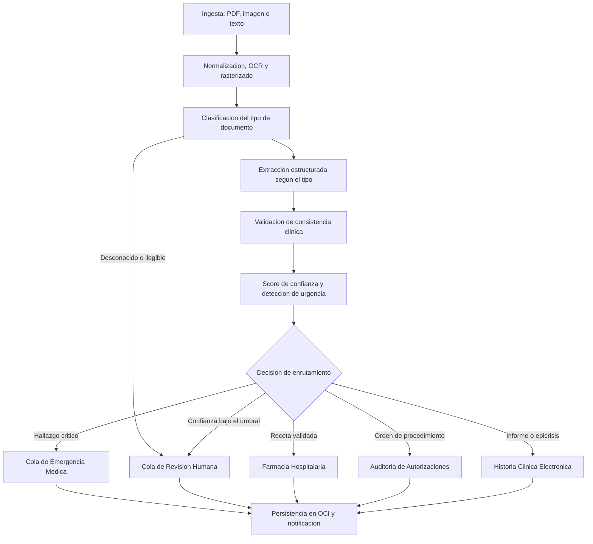

# MediFlow

Sistema inteligente para el procesamiento, clasificación, extracción y triaje automatizado de documentos clínicos.

**Hackathon ONE G10 — Oracle Next Education & Alura · Proyecto 2 · Equipo 46 (LATAM)**

[Plan de ejecución de las cinco semanas](docs/index.html) · [Contrato de la API](docs/CONTRATO.md) · [Cómo trabajamos](CONTRIBUTING.md)

---

## El problema

Hospitales, laboratorios y aseguradoras de salud pierden miles de horas con equipos
administrativos leyendo manualmente informes y recetas para transcribir datos en
sistemas heredados. Además de lento y costoso, el proceso manual está sujeto a errores
de tipeo y a demoras en la atención de pacientes con cuadros de urgencia.

Un informe de tromboembolismo pulmonar que espera tres días en una bandeja no es un
problema administrativo. Es un problema clínico.

## La solución

Un agente autónomo que recibe un documento clínico en PDF, imagen o texto, lo
clasifica, extrae los datos clínicos esenciales, evalúa su confianza y su urgencia, y
lo enruta al destino correcto: sin intervención humana en los casos estándar, y
escalando a un auditor humano cuando hay ambigüedad.

**Dos reglas que no se negocian.** Primera: ante cualquier duda, fallo del modelo o
documento ilegible, el caso escala a una persona; nunca a aprobación automática.
Segunda: si un dato no está en el documento, el campo va en `null` y baja la
confianza. Un código CIE-10 inventado es peor que un campo vacío.

## Grafo de decisión del agente



## Arquitectura General

* Frontend
* Backend
* Agente IA
* OCI Object Storage

## Módulos del Proyecto

* **`agente/`**: Inteligencia artificial y procesamiento documental.
* **`backend/`**: API y lógica de integración.
* **`frontend/`**: Interfaz de usuario.
* **`infrastructure/`**: Infraestructura y servicios cloud.
* **`docs/`**: Plan de ejecución, contrato de la API y documentación del proyecto.

## Contrato de la API

El sistema expone un endpoint de triaje que recibe un documento y devuelve la
clasificación, los datos extraídos y la decisión de enrutamiento.

La definición completa, con los valores admitidos de cada campo y las reglas de
forma, está en **[docs/CONTRATO.md](docs/CONTRATO.md)**. Ese documento manda sobre
cualquier otra definición del repositorio.

## Organización del bucket en OCI Object Storage

Un único bucket Always Free, segregado por estado del documento:

```
mediflow-documentos-clinicos/
  recibidos/                  documento original, tal como llego
  procesados/
    rutina/                   confianza alta, ruta automatica
    urgentes/                 hallazgo critico o prioridad urgente
  auditoria_humana/           confianza baja o documento ambiguo
```

Un documento que entra por `recibidos/` termina siempre en exactamente uno de los
otros tres prefijos. Si un objeto queda solo en `recibidos/`, es que el flujo se
cortó y hay que investigarlo.

## Stack

| Capa                  | Tecnología                          |
|-----------------------|-------------------------------------|
| Lenguaje              | Python 3.12                         |
| Modelo de lenguaje    | Google Gemini (`gemini-3.5-flash-lite`) |
| Integración con el modelo | LangChain, con salida estructurada por Pydantic |
| Grafo de decisión     | Python puro, bifurcaciones explícitas |
| Validación de datos   | Pydantic v2                         |
| Pruebas               | Pytest — 287                        |
| API                   | FastAPI + uvicorn                   |
| Interfaz de triaje    | Página web propia (HTML, CSS y JS sin framework) |
| Lectura de PDF        | pypdfium2; escaneos e imágenes se transcriben con Gemini |
| Almacenamiento        | OCI Object Storage, capa Always Free |
| Despliegue            | Docker sobre OCI Compute, capa Always Free |

Dos decisiones que conviene explicar, porque el enunciado sugiere otra cosa:

- **El grafo es Python puro, no LangGraph.** El enunciado admite las tres vías
  —LangGraph, n8n o *"pipeline condicional en Python con bifurcaciones"*— y la
  tercera permite que el grafo sea una función sin estado, con 287 pruebas que
  recorren sus ramas sin levantar nada ni llamar al modelo. Esa testabilidad
  pesó más que el framework.
- **La interfaz no es Streamlit ni Gradio.** El enunciado las sugiere pero
  permite *"frameworks web equivalentes"*. Una página propia servida por el
  mismo FastAPI evita un segundo proceso en una máquina Always Free de 1 GB.

## Reglas de triaje configurables

El gestor hospitalario cambia el comportamiento del agente editando
[`agente/config/triaje.toml`](agente/config/triaje.toml), **sin tocar el código
fuente ni reconstruir la imagen**:

| Sección | Qué controla |
|---------|--------------|
| `[confianza]` | Por debajo de qué confianza un caso va a revisión humana |
| `[urgencia]` | Qué vías de detección están activas y qué canales elevan la prioridad |
| `[destinos]` | A qué departamento va cada tipo de documento |
| `[rendimiento]` | Límites de ritmo contra la cuota del modelo |

Precedencia: variable de entorno, luego archivo, luego valor por defecto.

Un tipo de documento que no figure en `[destinos]` **se queda sin ruta
automática y escala a revisión humana**. Es a propósito: así se desactiva un
destino que todavía no está listo para recibir documentos sin supervisión. Un
destino mal escrito se descarta con un aviso en el log en vez de impedir el
arranque — un error de tipeo en un TOML no puede dejar una guardia sin triaje.

## Alertas en tiempo real

Ante un hallazgo crítico el agente genera una notificación, que siempre viaja
en el JSON de la respuesta como fija el contrato. Si además se configura un
canal, **se entrega de verdad**:

```env
MEDIFLOW_ALERTA_WEBHOOK=https://hooks.slack.com/services/...
# o, por correo:
MEDIFLOW_SMTP_HOST=smtp.gmail.com
MEDIFLOW_ALERTA_EMAIL=guardia@hospital.ejemplo
```

El webhook sirve para Slack, Discord, Teams o un nodo Webhook de n8n. Sin nada
configurado el sistema funciona igual y no intenta salir a la red.

**Un canal caído nunca invalida un triaje.** La alerta se envía *después* de
persistir el documento, con cinco segundos de límite, y cualquier fallo queda
en el log. El orden importa: al revés, una guardia avisada de un caso que
todavía no está en el bucket no tendría dónde ir a verlo.

## Ejecución

El módulo del agente tiene su propia guía de instalación y ejecución:
**[agente/README.md](agente/README.md)**.

> **Nunca subas el archivo `.env`.** Cada quien crea el suyo a partir de
> `agente/.env.example` con su propia clave.

## Estado del Proyecto

**Semana 4 completa.** El agente está desplegado y accesible en
**http://159.112.180.217**. Los siete requisitos mínimos del enunciado están
cubiertos y cuatro de los cinco diferenciales también.

| Semana | Fechas          | Hito                      | Estado |
|--------|-----------------|---------------------------|--------|
| 1      | 21 al 27 sep    | Esqueleto vivo            | Hecho  |
| 2      | 28 sep al 4 oct | Lee cualquier formato     | Hecho  |
| 3      | 5 al 11 oct     | El agente decide          | Hecho  |
| 4      | 12 al 18 oct    | Producto y panel humano   | Hecho  |
| 5      | 19 al 25 oct    | Entrega                   | Video demo pendiente |

El plan completo de las cinco semanas está en la
**[página del plan de ejecución](docs/index.html)**, un archivo HTML que se
abre con doble clic una vez que clonaste el repositorio.

### Cómo se verifica

| Qué | Cómo |
|-----|------|
| Nada se rompió | `pytest -q` en `agente/` — 287 pruebas, sin llamar al modelo |
| Qué tan bien acierta | `python scripts/evaluar_corpus.py` sobre 30 documentos etiquetados |
| Que ningún urgente se escape | `python scripts/evaluar_urgencia.py` sobre 95 frases clínicas |

Medido sobre el corpus, en tres corridas: clasificación 29/30, cobertura de
campos entre 97% y 99%, y **cero falsos negativos de urgencia en las tres**.
El modelo no es determinista, así que una sola corrida no sostiene una
afirmación sobre décimas: los números de arriba son el rango observado, no un
punto.

Fecha límite de entrega: **27 de octubre de 2026**.

## Los tres escenarios de la demostración

El enunciado exige demostrar al menos tres casos distintos. Los usamos además como
prueba de aceptación en cada sprint.

1. **Flujo estándar aprobado.** Orden de estudio de laboratorio ambulatoria, legible
   y completa. Confianza alta, ruta automática a Auditoría de Autorizaciones, objeto
   en `procesados/rutina/`.
2. **Prioridad de urgencia médica.** El informe de tromboembolismo pulmonar del
   enunciado. Prioridad urgente, ruta a Cola de Emergencia Médica, notificación al
   canal de guardia, objeto en `procesados/urgentes/`.
3. **Caso ambiguo derivado a auditoría humana.** Foto de receta manuscrita con la
   dosis ilegible. Confianza baja, campos en `null`, ruta a Cola de Revisión Humana,
   objeto en `auditoria_humana/`. El auditor corrige, aprueba, y el documento sigue
   hacia Farmacia.

## Equipo

Ocho personas repartidas en dos frentes de cuatro.

**Equipo A, agente e inteligencia.** Todo lo que ocurre entre que llega un documento
y sale una decisión: ingesta, clasificación, extracción, confianza, urgencia y grafo
de enrutamiento.

**Equipo B, plataforma y producto.** Todo lo que rodea al agente: API,
almacenamiento en OCI, interfaz de triaje, panel de auditoría, pruebas,
documentación y demostración.

| Nombre | Rol | GitHub | Equipo |
|--------|-----|--------|--------|
| Eddy Daniel Mujica Ramirez | Autonomous Agent Engineer | [@EdMRamirez](https://github.com/EdMRamirez) | A |
| Alex Danilo Loaiza Gomezcuello | Data analyst | [@Danloa7890](https://github.com/Danloa7890) | A |
| Cristina Torrico | Data analyst | *(completar)* | A |
| Neri Ferreira | Full Stack Developer | [@nfexcelsis](https://github.com/nfexcelsis) | A |
| Diana Palacios | Software Engineer | *(completar)* | B |
| Cristian Emanuel Ceron Franco | Backend Developer | *(completar)* | B |
| Nicole Fernandez | Full Stack Developer | *(completar)* | B |
| Alejandro Gonzalez Ugalde | UX/UI Designer | [@Alex25008441-STEM](https://github.com/Alex25008441-STEM) | B |

## Enlaces del proyecto

| Recurso                  | Enlace |
|--------------------------|--------|
| Repositorio              | https://github.com/No-Country-simulation/G10-LATAM-EQUIPO-46-MediFlow |
| Plan de ejecución        | [`docs/index.html`](docs/index.html) (se abre local) |
| Video demo               | *(completar, semana 5)* |
| Despliegue               | http://159.112.180.217 (OCI Compute Always Free) |

