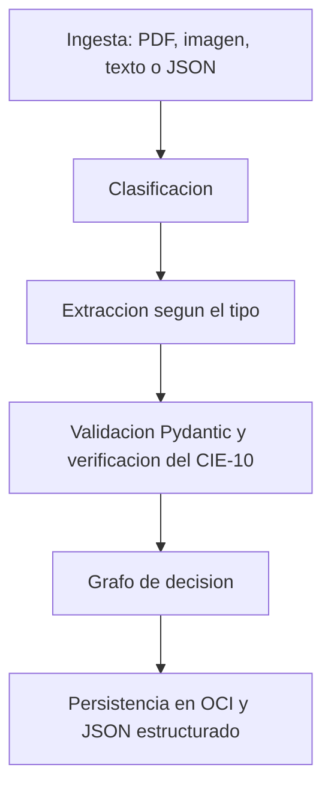

# MediFlow Agent

Módulo de inteligencia artificial encargado del procesamiento y análisis de documentos clínicos para el proyecto MediFlow.

## El flujo



El grafo de decisión completo, con sus nueve pasos y el enrutamiento a los
cinco destinos, está en el
[README de la raíz](../README.md#grafo-de-decisión-del-agente).

## Tecnologías

* **Python 3.12** (núcleo del desarrollo)
* **Gemini** (modelo de lenguaje; también transcribe escaneos e imágenes)
* **LangChain** (integración con el modelo y salida estructurada)
* **Pydantic v2** (validación de estructuras de datos)
* **FastAPI + uvicorn** (API y página de triaje)
* **pypdfium2** (lectura de la capa de texto de los PDF)
* **Pytest** (318 pruebas, ninguna llama al modelo)

El grafo de decisión es Python puro, no LangGraph. El enunciado admite
*"pipeline condicional en Python con bifurcaciones"*, y esa vía permite
recorrer todas las ramas en las pruebas sin levantar nada ni gastar cuota.

## Categorías de Clasificación

Actualmente el clasificador reconoce estrictamente las siguientes categorías de documentos:

* receta_medica
* informe_estudio_diagnostico
* orden_procedimiento
* epicrisis
* certificado_medico
* desconocido

## Guía de Ejecución

Sigue estos pasos en la terminal para configurar y correr el agente localmente:

### 1. Crear y activar el entorno virtual
```bash
python -m venv .venv

# En PowerShell:
.\.venv\Scripts\Activate.ps1

# En CMD clásico de Windows:
.\.venv\Scripts\activate.bat
```

### 2. Instalar dependencias
```bash
pip install -r requirements.txt
```

### 3. Configurar variables de entorno
Crea un archivo llamado `.env` en la raíz de este módulo y define tus credenciales:
```env
GEMINI_API_KEY=TU_API_KEY
GEMINI_MODEL=
```

### 4. Ejecutar el agente
Para correr el script principal, debes indicarle a Python dónde encontrar el código fuente. Elige el comando según tu terminal:

* **En CMD (Símbolo del sistema):**
  ```cmd
  set PYTHONPATH=src&& python -m mediflow_agent.main examples/informe.txt
  ```
* **En PowerShell:**
  ```powershell
  $env:PYTHONPATH="src"
  python -m mediflow_agent.main examples/informe.txt
  ```

### 5. Levantar la API de triaje

```bash
uvicorn mediflow_agent.api.app:app --reload --app-dir src
```

Queda en `http://127.0.0.1:8000`. La documentación interactiva está en
`http://127.0.0.1:8000/docs`: desde ahí se puede pegar el JSON del enunciado y
ver la respuesta completa sin escribir una sola línea de código.

Dos endpoints:

| Método | Ruta | Para qué |
|--------|------|----------|
| `GET`  | `/salud` | Comprobar que el servicio está arriba. No llama al modelo ni gasta cuota. |
| `POST` | `/triaje` | Documento en **texto**. Cuerpo JSON. |
| `POST` | `/triaje/archivo` | Documento en **PDF o imagen**. Subida multipart. |

Los dos devuelven exactamente la misma respuesta: el formato de entrada no
cambia nada de lo que recibe el consumidor.

#### Qué formatos lee

| Entra | Cómo se lee |
|-------|-------------|
| Texto plano | Directo. |
| PDF nativo | Capa de texto del PDF. No gasta cuota del modelo. |
| PDF escaneado | Se rasterizan las páginas y las transcribe el modelo multimodal. |
| Imagen (foto, captura) | Se normaliza y la transcribe el modelo multimodal. |

Se usa Gemini multimodal en vez de un OCR tradicional, como sugiere el
enunciado. Eso evita depender de Tesseract, que en Windows es una instalación
externa aparte.

El caso peligroso está contemplado: un PDF con una **capa de texto pobre** —un
escaneo al que alguien le pasó un OCR malo— parece éxito y no lo es. Se detecta
por densidad de caracteres por página y se transcribe igual.

Prueba rápida con el caso del enunciado:

```bash
curl -X POST http://127.0.0.1:8000/triaje ^
  -H "Content-Type: application/json" ^
  -d "{\"documento_id\":\"DOC-CLIN-2026-8942\",\"tipo_archivo\":\"TEXTO\",\"documento_texto\":\"CONCLUSION: Cuadro compatible con Tromboembolismo Pulmonar Agudo.\",\"canal_origen\":\"Guardia_Emergencias\"}"
```

El formato exacto de entrada y salida está en
[`docs/CONTRATO.md`](../docs/CONTRATO.md).

#### Dónde se guardan los documentos

Mientras no exista el bucket de OCI (tarea 1.2), la persistencia va a disco con
**exactamente la misma estructura de prefijos** que tendrá el bucket:

```
.almacen/
  recibidos/              el documento tal como llego
  procesados/rutina/      confianza alta, ruta automatica
  procesados/urgentes/    hallazgo critico o prioridad urgente
  auditoria_humana/       confianza baja o documento ambiguo
```

Para usar OCI Object Storage, que es lo que exige el enunciado, se cambia una
variable. Hay dos formas:

**Con un Pre-Authenticated Request (PAR).** Es lo más rápido: no hace falta
usuario, ni clave de API, ni acceso a la consola. Solo el enlace.

```env
MEDIFLOW_ALMACEN=par
MEDIFLOW_OCI_PAR=https://objectstorage.<region>.oraclecloud.com/p/.../o/
```

> **Ese enlace es la credencial.** Quien lo tenga puede leer y escribir en el
> bucket. No va al repositorio ni a un canal público, y **caduca** en la fecha
> que se eligió al crearlo.

**Con credenciales IAM propias.** Es la vía normal y no caduca.

```env
MEDIFLOW_ALMACEN=oci
MEDIFLOW_BUCKET=nombre-del-bucket
```

más las variables `OCI_*` del `.env.example`.

Ni el endpoint ni el servicio se enteran de cuál de los tres almacenes está en
uso.

#### Verificar la conexión con OCI

```bash
python scripts/verificar_oci.py
```

Sube un objeto de prueba a los cuatro prefijos, lo vuelve a leer y compara el
contenido. Es la prueba de subida y descarga que pide la tarea 1.2. Si algo
falla, dice qué revisar en lugar de mostrar una traza.

#### Obtener las credenciales

En la consola de OCI: **perfil → My profile → API keys → Add API key**. Al
generarla, OCI muestra un bloque de configuración con el OCID del usuario, el
de la tenancy y el fingerprint, y descarga un archivo `.pem` con la clave
privada.

> **El `.pem` nunca va al repositorio.** El `.gitignore` lo bloquea, pero la
> red de seguridad no reemplaza mirar tu propio `git diff`.

Dos variables opcionales:

```env
MEDIFLOW_ALMACEN_LOCAL=.almacen
MEDIFLOW_BUCKET=mediflow-documentos-clinicos
MEDIFLOW_UMBRAL_CONFIANZA=0.70
```

### Ejecución de las Pruebas Unitarias

```bash
python -m pytest
```

`pytest.ini` ya pone `src/` en la ruta de importación, así que no hace falta
exportar `PYTHONPATH` a mano.

Las pruebas **no llaman a Gemini**: el modelo se sustituye por dobles. Corren
en menos de un segundo y no consumen cuota, que es la contramedida al riesgo
de quedarse sin llamadas gratuitas a mitad de la semana.

## La página web de triaje

```bash
uvicorn mediflow_agent.api.app:app --app-dir src
```

Y abrir `http://127.0.0.1:8000` en el navegador. Es una página web
normal (HTML, CSS y JavaScript) servida desde la misma
aplicacion: un solo comando y un solo proceso, sin nada mas que levantar.

**Dos regiones.** A la izquierda, la conversacion: se pega un documento y el
agente responde con su decision — tipo, prioridad, destino, la justificacion
escrita y los datos extraidos, con los campos vacios marcados como tales. A la
derecha, las bandejas por estado, leidas **del almacen**, no de la memoria: lo
que se ve es lo que hay en el bucket, incluso lo que proceso otra persona.

**El color es informacion.** Cada estado del grafo tiene el suyo y siempre el
mismo: urgente en coral, revision humana en ambar, rutina en verde. El acento
del producto es teal y no se usa para ningun estado, para que nunca se confunda
una marca de interfaz con una senal clinica.

**El panel de auditoria** cierra el escenario 3 del enunciado. Al abrir un caso
pendiente se ve el documento original junto a lo extraido, con los campos
faltantes resaltados. El auditor los completa y aprueba, y **el agente vuelve a
decidir** la ruta con los datos corregidos.

Que re-decida el agente y no elija el auditor no es un detalle: si el auditor
pudiera mandar un documento a cualquier cola, el grafo dejaria de ser la unica
autoridad sobre el enrutamiento y nadie podria auditar por que un documento
termino donde termino. El auditor decide **que dice** el documento; el agente
decide **a donde va**.

| Endpoint | Para que |
|----------|----------|
| `GET /` | La página |
| `GET /bandeja?prefijo=...` | Casos de un prefijo, urgentes primero |
| `GET /documentos/{id}` | La decision guardada y el documento original |
| `POST /documentos/{id}/aprobar` | Correcciones del auditor y re-enrutamiento |

> **Nota sobre el PAR.** OCI no concede DELETE a traves de un
> Pre-Authenticated Request. Al aprobar, si el almacen no permite borrar el
> objeto de su prefijo anterior, se lo sobreescribe con la decision nueva para
> que las dos copias digan lo mismo. Con credenciales IAM se borra de verdad.

## Tiempo de respuesta

El requisito es resolver un documento en **10 segundos o menos**. No es una
meta de rendimiento: un informe de guardia que tarda un minuto en enrutarse no
sirve para nada.

Medido sobre un informe real, clasificando y extrayendo con la misma clave:

| Modelo | Clasificación | Extracción | Total |
|--------|---------------|------------|-------|
| `gemini-3.5-flash-lite` | 0,9 s | 1,2 s | **2,1 s** |
| `gemini-flash-lite-latest` | 1,0 s | 1,1 s | 2,1 s |
| `gemini-3.7-flash` | 79,0 s | 44,8 s | **123,8 s** |
| `gemini-3.8-flash` | — | — | cuota libre: **20 pedidos por día** |

Los modelos que razonan antes de responder tardan dos minutos. Por eso el
proyecto usa un modelo *lite* por defecto.

Además, **el clasificador y el extractor corren en paralelo**: el extractor
genérico no necesita saber el tipo de documento, así que las dos llamadas
salen a la vez. Eso baja el total a poco más de un segundo.

Medido de punta a punta sobre los tres escenarios del enunciado: **1,0 a
1,3 segundos** por documento.

> La velocidad está medida; **la exactitud todavía no**. Un modelo más chico
> puede acertar menos. Se mide con `scripts/evaluar_corpus.py` sobre los 30
> documentos etiquetados. Si no alcanza, hay que subir de modelo sin pasarse
> del presupuesto de tiempo, no resignar el tiempo.

## Deteccion de urgencia por doble via

El peor fallo posible del sistema es que un hallazgo urgente se clasifique
como rutina. La deteccion corre por **dos vias independientes**, y basta con
que **una** diga urgente para que el caso vaya a la cola de emergencia.

**Por que dos.** Se midio una sola via —la lista de terminos— contra 95
frases clinicas:

| Grupo | Acierto con lista sola |
|-------|------------------------|
| Urgentes nombrados con un termino de la lista | 25/25 — 100% |
| **Urgentes descritos SIN termino de la lista** | **2/30 — 7%** |
| Documentacion de rutina | 20/20 — 100% |
| Negaciones ("se descarta infarto") | 0/20 — 0% |

La lista se habia agrandado de 17 a **185 terminos** antes de medir. Diez
veces mas palabras, y los cuadros descritos por anatomia o por valores de
laboratorio se seguian escapando en un 93 por ciento. El problema no es el
tamano de la lista: una lista compara texto, no entiende lo que lee.

*"Obstruccion completa de la arteria descendente anterior"* describe un
infarto sin decir "infarto".

**Las dos vias:**

| Via | Que aporta | Costo |
|-----|------------|-------|
| **Lista** de 185 terminos en 11 grupos | Instantanea, gratis, sigue en pie aunque el modelo este caido o sin cuota | 0 llamadas |
| **Modelo** evaluando el cuadro | Entiende lo que la lista no puede nombrar | 1 llamada |

**El filtro de negacion.** Una lista grande trae su propio dano: las 20
negaciones del banco disparaban todas. Ahora se mira hacia atras hasta la
puntuacion anterior buscando "sin", "descarta", "ausencia de", "antecedente
de". Quedan 2 falsos positivos, ambos de cuadros ya resueltos donde la marca
va *despues* del termino. Se dejan a proposito: suprimirlos requeriria reglas
que podrian callar una urgencia real.

**Como se mide:**

```bash
python scripts/evaluar_urgencia.py            # solo la lista, gratis
python scripts/evaluar_urgencia.py --modelo   # las dos vias
```

La via por lista no cuesta una sola llamada, asi que se puede correr contra
un banco tan grande como se arme.

## Reglas de triaje configurables

Los umbrales y los destinos viven en [`config/triaje.toml`](config/triaje.toml),
no en el codigo. Es lo que pide la tarea 3.2 y habilita el diferencial del
enunciado: que un gestor hospitalario ajuste el triaje sin tocar una linea.

Precedencia: **variable de entorno > archivo > valor por defecto**.

Un archivo ausente o con un error de tipeo no tumba el sistema: se cae a los
valores por defecto y se sigue. Lo contrario significaria que un TOML mal
escrito deja sin atender una guardia.

## Verificacion de codigos CIE-10

Un modelo de lenguaje puede devolver un codigo con forma perfecta que no
existe: `I29.4` se ve tan creible como `I26.9`, y nadie lo nota leyendo la
respuesta. Por eso todo codigo sugerido se contrasta contra el catalogo local
de `src/mediflow_agent/datos/cie10_categorias.txt`, y si no existe se descarta.

**Que verifica y que no**, porque una verificacion que promete de mas es peor
que ninguna:

| | |
|---|---|
| Verifica la forma del codigo | si |
| Verifica que la categoria de tres caracteres exista | si |
| Verifica que el codigo sea el correcto para el diagnostico | **no** — eso lo decide una persona |
| Verifica el cuarto caracter contra la CIE-10 de la OMS | **no** — el catalogo no llega a esa granularidad |

**Procedencia del catalogo.** Son 1.907 categorias derivadas de ICD-10-CM,
publicado por CMS (Estados Unidos), que es de dominio publico. No se usa la
CIE-10 de la OMS porque esta bajo licencia Creative Commons
Attribution-NoDerivatives, que prohibe producir adaptaciones, y reformatearla a
este archivo seria una. Las categorias de tres caracteres son comunes a las dos
clasificaciones.

**Hueco conocido:** la version de la fuente es anterior a 2020 y no traia el
capitulo U. Las cuatro categorias U (COVID-19) se agregaron a mano y estan
marcadas como tales en el archivo. Conviene refrescar el catalogo desde una
version vigente de CMS antes de la entrega final.

## Reglas Importantes del Agente

Para garantizar la seguridad y fiabilidad clínica, el comportamiento del Agente está blindado bajo las siguientes reglas:

1. **Evidencia estricta:** Extraer solamente información explícitamente disponible en el documento.
2. **Uso de nulos:** Utilizar `null` (`None`) cuando un dato no esté disponible en el texto.
3. **Cero alucinaciones:** No inventar ni inferir información clínica que no esté firmada por el médico.
4. **Validación estricta:** Validar los tipos y límites de todas las estructuras mediante Pydantic (ej. confianza entre 0 y 1).
5. **Alcance de Codificación:** Tratar `suggested_icd10` únicamente como una sugerencia automatizada y jamás como un diagnóstico definitivo.

